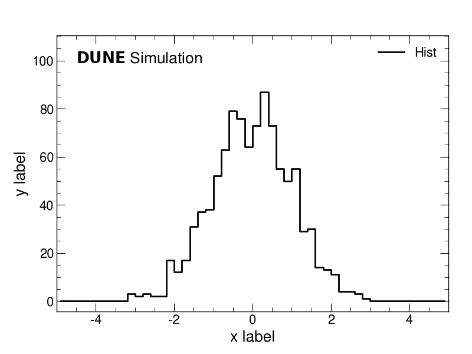
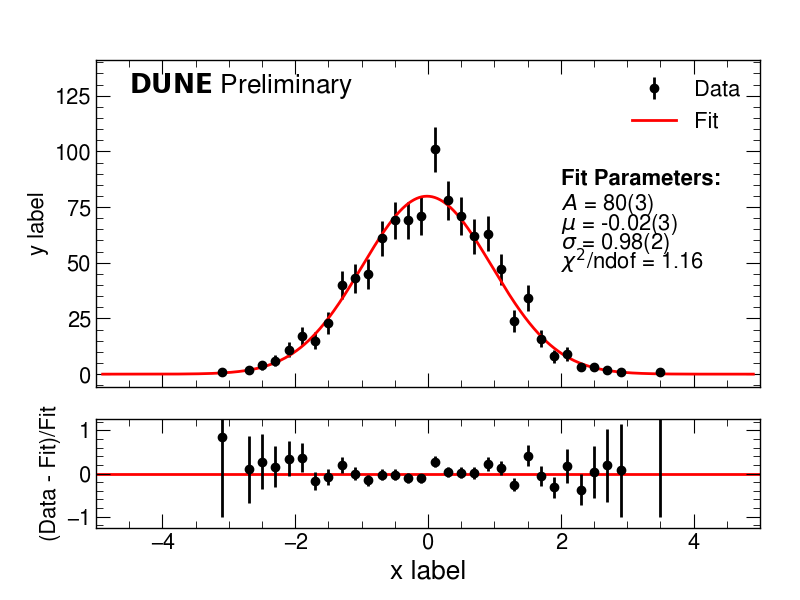
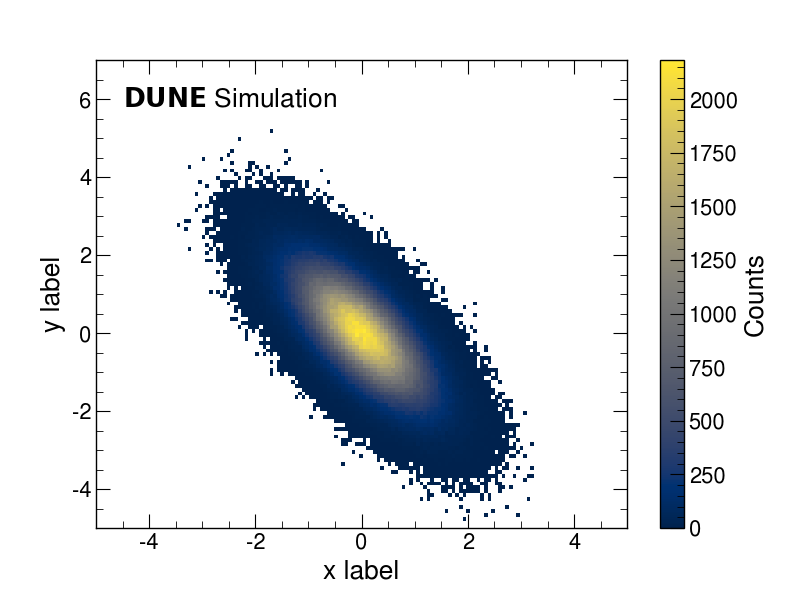
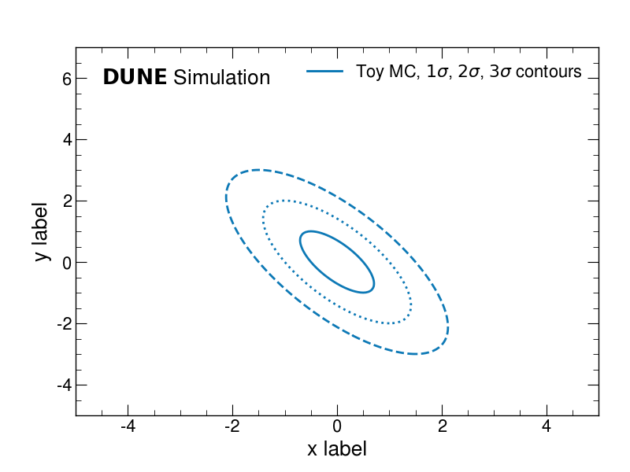
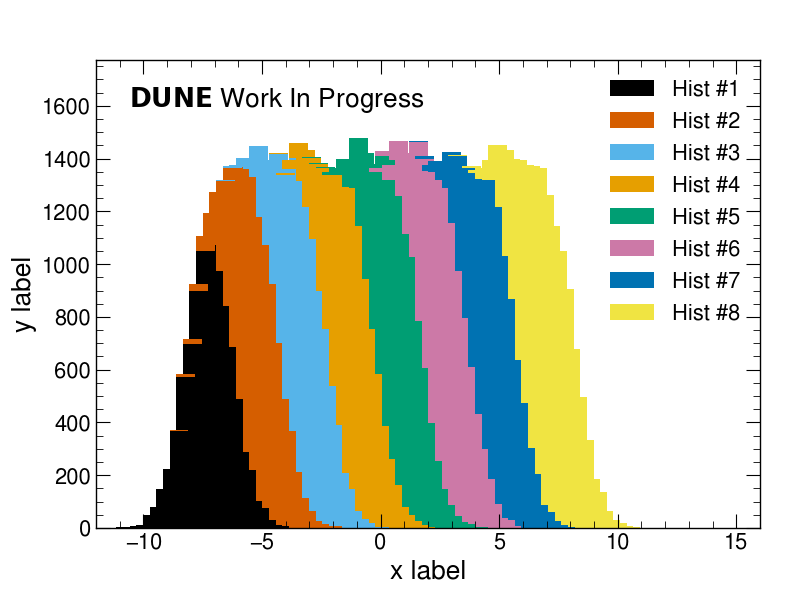
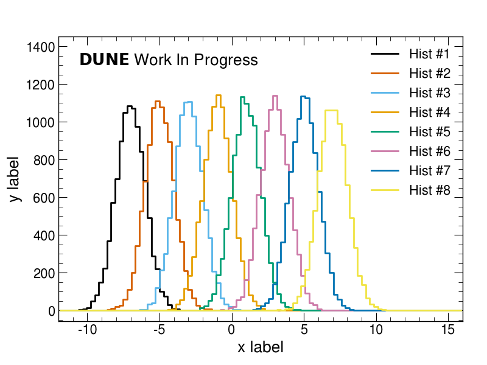
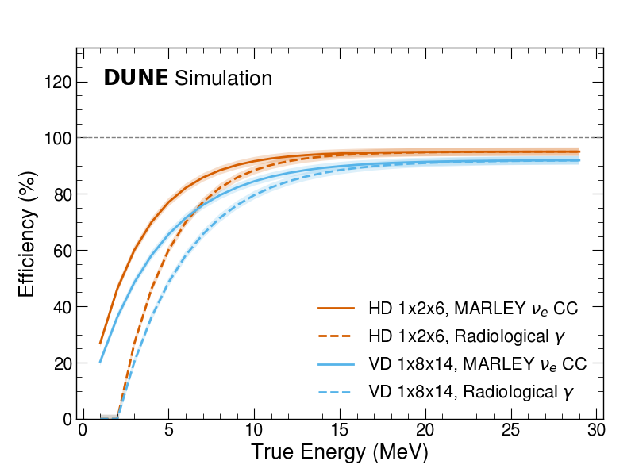
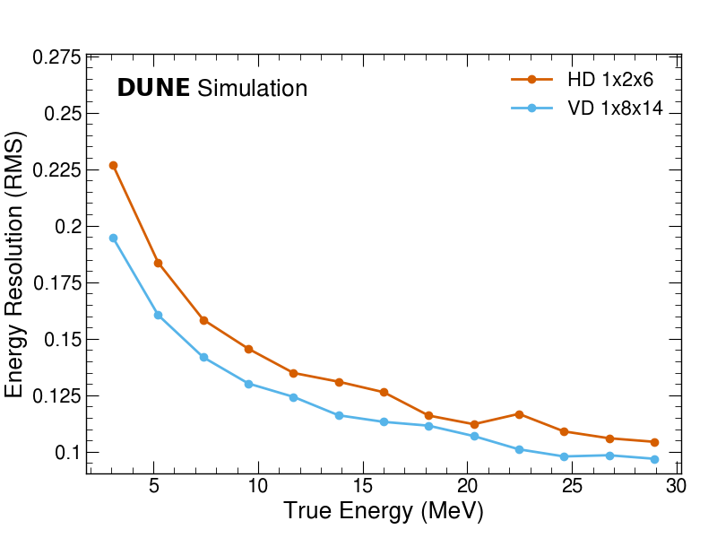
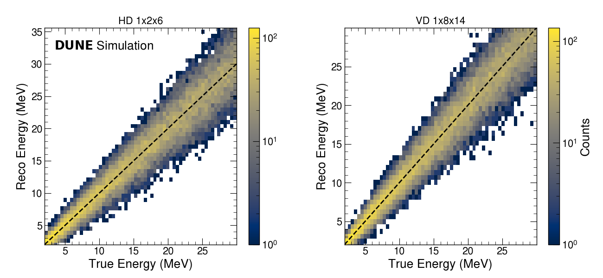

# DUNE matplotlib style examples

Template repository for DUNE plots and tables that follow the official
[dune_plot_style](https://github.com/DUNE/dune_plot_style), drawn with
[plotipus](https://github.com/mantheys/plotipus).

The analysis writes its results as pickled pandas DataFrames; every figure is
then **one line** in a plain-text command list:

```bash
hist --datafile Hist1D -x Values --hue Sample --bins 50 --rangex -5 5 --dune_label simulation
```

Styling (DUNE style sheet, Okabe-Ito colours, `DUNE Simulation` /
`DUNE Preliminary` watermarks) is applied by a small plotipus plugin, so the
command lists only describe *what* to draw.

| | | |
|---|---|---|
|  |  |  |
|  |  |  |
|  |  |  |

The first six reproduce the examples shipped with dune_plot_style
(`examples/matplotlib/example.py`); the last row shows typical analysis
figures (one curve per detector configuration and sample, binned estimators,
per-configuration 2D maps).

## Quick start

```bash
git clone https://github.com/DUNE/matplotlib_dunestyle_examples.git
cd matplotlib_dunestyle_examples
source setup.sh             # .venv with dune_plot_style + plotipus
python run.py               # toy data, then every figure and table
```

Figures land in `output/plots`, LaTeX/HTML tables in `output/tables`.
`source setup.sh --latest` installs the newest dune_plot_style release
instead of the pinned one.

Once the data exist, single lists or commands run directly:

```bash
plotipus run dune                    # input/plots/dune_scripts.txt
plotipus run showcase --match Events # only the matching commands
plotipus run dune --tables           # input/tables/dune_scripts.txt
plotipus line --help                 # every option of a plot kind
```

## Layout

```
plotipus.toml                 project: data root, command lists, style, plugin
config/style.json             label/colour mappings, legend conventions
src/dune_plotipus/            plugin: DUNE style sheet + watermark options
input/data/                   result files (*.pkl in Git LFS) + MANIFEST.csv
input/plots/*_scripts.txt     one figure per line
input/tables/*_scripts.txt    one table per line
run.py                        every list (plus data check) in one go
scripts/data_manifest.py      freeze/verify the data (sizes, MD5, origin)
scripts/new_project.py        strip the examples from a new project
output/                       generated (git-ignored)

Examples only (removed by scripts/new_project.py):
scripts/make_example_data.py  stand-in for an analysis: writes input/data/examples/*.pkl
docs/gallery/                 the figures shown above
```

## Making your own plots

1. **Store results as DataFrames**, one row per series, whole arrays in the
   cells (see `scripts/make_example_data.py`):

   ```python
   pd.DataFrame([{"Energy": energy, "Efficiency": eff, "EfficiencyError": err,
                  "Config": "hd_1x2x6", "Name": "marley", "Variable": "Efficiency"}]
                ).to_pickle("input/data/my_study/hd_1x2x6_marley_Efficiency.pkl")
   ```

   A `<Column>Error` column is picked up by `--errory`; `Config`/`Name`
   columns (and the `{config}_{name}_{datafile}.pkl` file names) let one
   command overlay detector configurations and samples. `--path my_study`
   points a command at a subfolder of `input/data`.

2. **Add a line** to a command list in `input/plots/`. The six plot kinds
   are `line`, `scatter`, `hist`, `map`, `cat` and `table`; lower panels
   (`--lower ratio`, `--lower residual`, ...), stored fits (`--fit`),
   binned estimators (`--binned --estimator rms`) and per-panel variables
   are options of the same commands. See the
   [plotipus README](https://github.com/mantheys/plotipus#readme).

3. **Name things once** in `config/style.json`: `config_dict`/`name_dict`
   give legend labels, `config_color`/`config_line` colours and line styles.

## DUNE options

The plugin (`src/dune_plotipus`) enables `dune.mplstyle` and adds these
options to every plot kind:

| Option | Default | |
|---|---|---|
| `--dune_label {simulation,preliminary,wip,official,simulation_side,none}` | `[settings] dune_label` | watermark on the first panel |
| `--dune_label_position X Y` | dunestyle's upper left | axes coordinates of the watermark |
| `--dune_label_size SIZE` | `xx-large` | watermark font size |
| `--dune_headroom FRACTION` | `0.2` | y range added on top so the watermark does not cover data |

`[settings] dune_colors = "logo"` in `plotipus.toml` switches to the
DUNE-logo subset of the Okabe-Ito palette. Approved results only may carry
the bare `official` watermark; follow the
[DUNE plot guidelines](https://github.com/DUNE/dune_plot_style/blob/main/guidelines.md).

## Starting a project from this template

1. Click *Use this template* on GitHub, clone the new repository, then strip
   the examples:

   ```bash
   git lfs install                                # once per machine
   python scripts/new_project.py "My analysis plots"
   git add -A && git commit -m "Start from the DUNE plot template"
   ```

   This removes the toy data generator, the example lists and the gallery,
   writes a short README, an empty `input/plots/main_scripts.txt` and a
   blank `config/style.json`, and switches CI to manual runs that fetch the
   LFS data.

2. Put your result files under `input/data/` (they are committed through
   Git LFS, see `.gitattributes`) and add commands to the lists.

3. For a publication, freeze what the figures were made from:

   ```bash
   python scripts/data_manifest.py --write   # input/data/MANIFEST.csv: size, MD5, origin (fill in)
   python scripts/data_manifest.py           # verify later (also run by run.py)
   ```

   and keep `requirements.txt` pinned (dune_plot_style release, plotipus
   commit) so the figures can be regenerated identically.

Extra output directories per list (e.g. a paper's `Figures/` folder) go in
`plotipus.toml`:

```toml
[outputs.plots]
paper = ["../my_paper/Figures"]
```

[DUNE/lowe_reco_paper_plots](https://github.com/DUNE/lowe_reco_paper_plots)
is a full example: every figure and table of a paper, its frozen data and a
file-by-file comparison with the paper repository.

## License

MIT, see [LICENSE](LICENSE).
